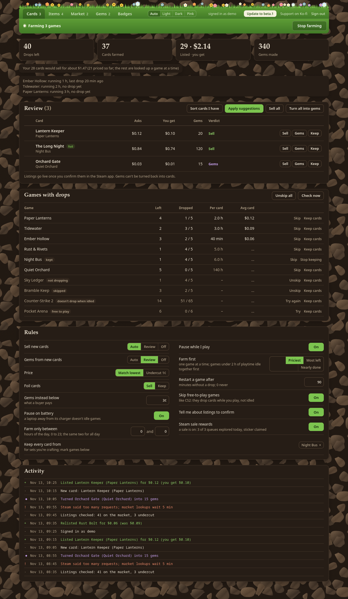
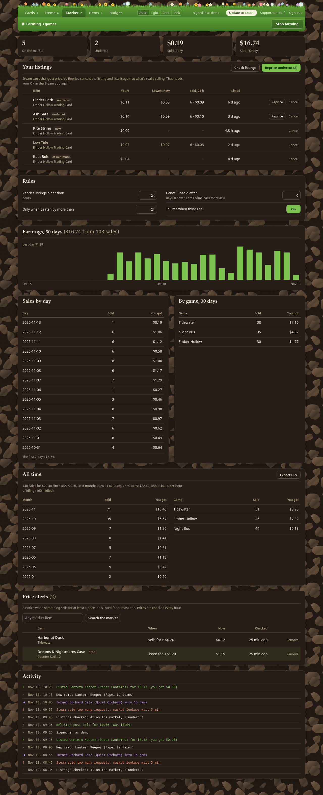

# Card Farmer's Market

Farm your Steam trading card drops on Linux, Windows or macOS, then sell each card or turn it into gems by rules you set.
Card Farmer's Market is a desktop app with its own window. It keeps farming in the background when you close it.

It looks like a little garden: the tabs sit on a strip of grass, and **a flower grows in the grass for every card
you farm**. Foil cards grow a shimmering one. Pick **Light**, **Dark** or **Pink** at the top, or **Auto** to follow
your system.



### Cards

- **Native idling.** It tells your running Steam client that a game is playing, the way the game itself would, through Steam's own API library. No Wine, Proton or helper programs.
- **Start and stop at the top.** One button starts or stops farming; the bar beside it says what's going on.
- **Playtime first, then one game at a time.** Most games don't drop cards before about 2 hours of playtime, and playtime counts for every running game, so games under 2 hours idle together first (up to 32 at once). After that, games idle one at a time, the order you pick (priciest cards, most drops left, or nearly done), since Steam drops cards for one running game far more readily than for several.
- **Notices stalls.** It checks your badges page as it goes. A game that stops dropping cards gets restarted, then set aside for a while. Games that never drop while idled are set aside for a week. When Steam restarts, the games are started again.
- **Skips free-to-play games.** Free-to-play games like Counter-Strike 2 give card drops for in-game purchases, and those come while you play the game yourself, not while it's idled, so they're skipped unless you choose **Try** (or turn the rule off). A game you **Skip** stays skipped until you unskip it; **Unskip all** brings every game back.
- **Sell or gems, decided per card.** Each card is priced against the market and against its gem value, using the current Sack of Gems price.
  - For selling and for gems separately, you choose **Auto**, **Review** (the card waits for you in the window) or **Off**.
  - You can also keep foils, keep every card from chosen games, set a minimum price, and match the lowest listing or undercut it by 1¢.
  - Only real card drops are handled automatically. A card that turns up any other way (a trade, a booster pack, one you bought to finish a badge) waits for your review.
- **Sort the cards you already have.** "Sort cards I have" runs your whole inventory through the same rules. Cards already listed and waiting for confirmation are left out.

### Items

The Items tab finds your other inventories (Counter-Strike 2, Team Fortress 2, the Steam inventory's backgrounds and emoticons, and so on) and prices what's marketable in the ones you switch on. Nothing is listed unless you say so: "New items" is Off until you change it, and its Auto mode only lists items that arrive after you turn it on. Items that haven't sold recently are left alone, so an old, high asking price isn't copied.

### Market



- **Your listings next to today's prices.** A listing counts as undercut when what really sells (the lower of the cheapest listing and the day's median sale) is below yours. "Reprice" cancels it and lists it again at that price; listings can also be cancelled after a number of days.
- **What you've earned.** A chart of the last 30 days, sales by day and by game, and an optional notice when something sells.

### Gems

- Pack gems into Sacks of Gems and sell them.
- **Booster packs worth making.** A pack is worth it when it sells for more than its gems would as sacks. It's valued at what it really sold for in the last day, and only counts if it sells at all. "Make & list all worth it" makes them with the gems you have.
- **Booster packs you have.** Each one is either sold as a pack or opened into 3 cards, whichever is worth more (or opened when it's for a set you're finishing). Opened cards go to the review list.

### Badges


- **Quick badge: one game to level 5.** Your badges are listed (started, not crafted yet, at level 5), along with the market's cheapest sets, and a search finds any game with trading cards. Pick one and every card's listings are read straight from the market's order book (how many are listed at each price), with the cards you already have counted, so the cost of each level up to 5 is exact. One button buys those listings and crafts the levels; if some sell first it buys the next ones, never more than 10% (at least 5¢) over the quote, and never more than your Steam wallet holds.
- **Finish sets.** Sets you hold most of are listed with what the missing cards cost. "Buy & craft" checks every missing card's price against your limit before buying anything, then crafts the badge. A set's cards aren't sold while you're finishing it.
- **Reach a Steam level.** Pick a Steam level and a budget. It finds the cheapest badge crafts: sets you hold part of (counting what your own cards would sell for instead), and the market's cheapest full sets. **Level up** then buys the cards and crafts the badges, either **now** at the cheapest listings, or with **buy orders** about 15% under the cheapest price that fill over hours or days (unfilled orders are cancelled after a week, or when you say). Each set is crafted as soon as its cards are in.

The Activity log sits under every tab.

### Everywhere

- **Pauses while you play.** When you launch a game from Steam, farming waits until you're done.
- **Easy on Steam's market.** Prices are looked up while signed in, a few seconds apart, and kept for a while. If Steam still says "too many requests", market lookups pause (5, then 10, then 30 minutes) and the window says when they'll start again.
- **Signs in by QR code** through the Steam mobile app, once: the sign-in renews itself for months. Card Farmer's Market never sees your password.
- **Updates itself.** When a new version is out, an Update button appears at the top of the window.

Market listings and purchases may need your OK in the Steam mobile app (Confirmations → Confirm all). Card Farmer's Market
tells you when some are waiting. Prices are looked up again just before each listing or purchase.

## Download

Get the latest version from the [Releases page](https://github.com/maybeimdreaming/card-farmers-market/releases):

- **Windows 10/11:** `Card-Farm-Windows.zip`. Unzip it and run `Card Farm.exe`. Windows may say the publisher is unknown: **More info → Run anyway**. Closing the window while farming minimises it; use **Quit** at the top of the page to stop.
- **macOS (Apple silicon and Intel):** `Card-Farm-macOS.zip`. Move `Card Farm` to Applications; the first time, right-click it and choose **Open** (it isn't notarised). (`Card-Farm-macOS-Intel.zip` is the same app, kept so older copies on Intel Macs can update.)
- **Linux:** `card-farm.pyz`. `chmod +x card-farm.pyz && ./card-farm.pyz`, or install with pipx as below.

Steam must be running and signed in, and you need the Steam mobile app with Steam Guard for the sign-in and for confirming market listings. Card Farmer's Market finds Steam's own API library (`steam_api64.dll`, `libsteam_api.dylib` or `libsteam_api.so`) in any game you have installed and doesn't ship a copy; on Linux, any Proton version has one.

### Linux requirements

- Python 3.10 or newer, and `curl`
- GTK 4, libadwaita and WebKitGTK 6 with their Python bindings (PyGObject). Most GNOME and KDE desktops have these already.

### Install on Linux with pipx

```sh
pipx install git+https://github.com/maybeimdreaming/card-farmers-market
card-farm
```

`card-farm` opens the window. To add it to your app menu:

```sh
curl -o ~/.local/share/applications/io.github.cardfarm.CardFarm.desktop \
  https://raw.githubusercontent.com/maybeimdreaming/card-farmers-market/main/extras/io.github.cardfarm.CardFarm.desktop
```

Closing the window while farming keeps Card Farmer's Market running in the background; open it again from the
menu to see it, or choose **Quit** in its menu to stop. Only one copy runs at a time.

To start farming when you log in, without opening the window (`card-farm --background`):

```sh
curl -o ~/.config/autostart/card-farm.desktop \
  https://raw.githubusercontent.com/maybeimdreaming/card-farmers-market/main/extras/card-farm-autostart.desktop
```

Opening Card Farmer's Market from the menu then shows that running copy. (On Windows and macOS, `--background`
starts Card Farmer's Market minimised.)

Settings, the review lists and your Steam sign-in are kept in `~/.local/share/card-farm` on Linux,
`%APPDATA%\Card Farm` on Windows and `~/Library/Application Support/Card Farm` on macOS; the sign-in
file is readable only by you. `farm-history.json` there lists every card the app has farmed (when, which, foil or not, and the version). `card-farm.log` there keeps what the Activity log showed and what went wrong behind it (it starts over at 1 MB): the file to attach when you report a problem. A settings or state file that got damaged is set aside as `<name>.broken` and the last good copy is used. `CARD_FARM_DATA` changes the folder.

## How the decision works

For each card, Card Farmer's Market compares two numbers:

1. What you'd receive from selling at the lowest current listing, after Steam's fee and the game's fee.
2. What the card's gems would fetch once sold as part of a 1,000-gem Sack of Gems.

The card is sold if the first number is higher, and turned into gems otherwise. Gems also win when
nobody is selling the card, or when the price is under your minimum. Gems are usually worth very
little, so most cards with a buyer end up sold.

Items other than cards are only ever sold (or kept). One is offered for sale when someone else is
selling it, it has sold recently, and the price is at least your "Don't list under" amount.

Buying (Finish sets and Level up) uses your Steam wallet, and never goes over the limit you set: prices are
checked again right before anything is bought, and a set that got dearer is skipped whole.

## Good to know

- Card drops come at Steam's pace, about one every 20–40 minutes of play per game. No tool can change that. What Card Farmer's Market saves is the time lost when an idler silently stalls.
- Turning a card into gems, opening a booster pack and crafting a badge can't be undone. Listings and buy orders can be cancelled in the window or on the Steam Market page.
- Card Farmer's Market doesn't run a web server or open a network port. Its window talks to the farm inside the same program, and only Steam's own servers are contacted.
- The Windows and macOS builds aren't signed by Microsoft or Apple, so the first start shows a warning (see Download).
- Card Farmer's Market is not affiliated with Valve. Use it on your own account, at your own pace.

## Development

```sh
python3 -m venv .venv && .venv/bin/pip install pytest
.venv/bin/python -m pytest tests
python3 -m cardfarm                # window
python3 -m cardfarm --background   # farm without opening the window
python packaging/build.py linux    # dist/card-farm.pyz; windows / macos need: pip install pyinstaller pywebview pillow
```

To check the layout after changing the page, `python3 tools/screenshots.py OUT_DIR` opens the real window on a
hidden display (needs `cage`), fills every tab with made-up data, and saves each tab wide, narrow and in the
light theme. It fails if anything scrolls sideways or the page's script throws. The pictures above come from it.

Releases are built by `.github/workflows/release.yml` when a `v*` tag is pushed. Each build is
opened once on a real Windows and macOS machine to check its window works before it's published.
The Mac app is built once for both kinds of Mac, on an Intel Mac with python.org's universal2 Python;
the build checks every program file in it has Apple silicon code too, and opens it on an Apple silicon
Mac as well when GitHub has one free (the release doesn't wait for that).

The code uses only the Python standard library, plus the system's web view for the window (GTK and
WebKitGTK on Linux; on Windows and macOS the pywebview library, which uses Edge WebView2 or WebKit),
and `curl` for web requests, because Steam's market rate-limits Python's own HTTP client much harder. The QR
code encoder (`cardfarm/qr.py`) and the icon were made for this project.

## Support

Card Farmer's Market is free. If it saves you some time, you can leave a tip on
[Ko-fi](https://ko-fi.com/m4ybe), also linked from the top of the app's window.

## Thanks

- [hardwarebob](https://github.com/hardwarebob), for the ideas behind clearer Steam errors, the shared "too many requests" pause and the farm history ([#1](https://github.com/maybeimdreaming/card-farmers-market/pull/1)).

## License

MIT. See [NOTICE.md](NOTICE.md) for credits that apply to early versions in this repository's history.
